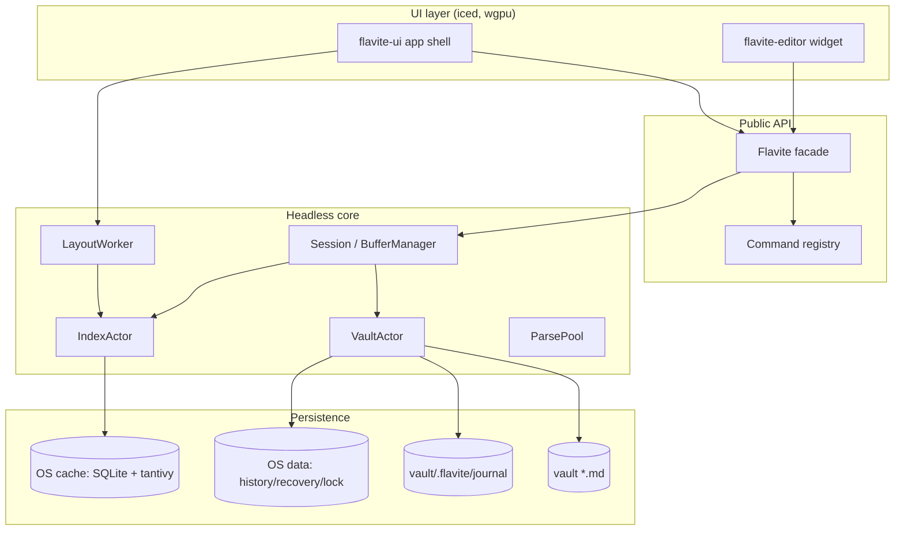
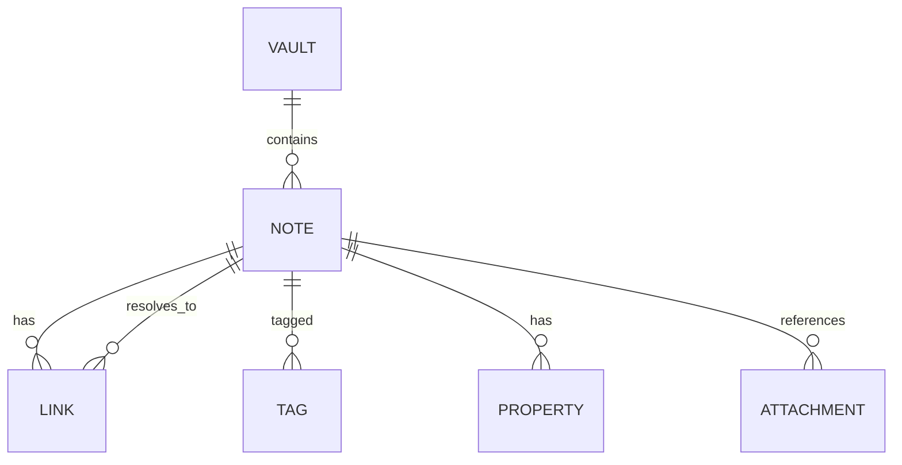

# Developer Documentation — Flavite

> Generated from the repository at `/home/lex/Public/EDITOR/flavite-editor` (workspace version `0.1.0`, edition 2024, MSRV 1.90.0). Source of truth is the code; where evidence is missing it is called out explicitly.

---

## 1. Executive Summary

**What it does.** Flavite is a desktop application that treats a folder of CommonMark (`*.md`) files as the only source of truth. It layers a rebuildable index (links, backlinks, tags, typed properties, full-text search) on top and renders a graph view with note cards at high zoom. Everything below the UI is a headless library with a CLI. The editor is a custom widget over a headless buffer model.

**Problem solved.** "Lost my notes" / "corrupted notes" bugs usually come from mixing state classes. Flavite makes the on-disk markdown the truth, keeps a disposable cache outside the vault, and uses a durable rename journal + local history so a lost race costs a restore, not data.

**Main consumers.**
- End users running the `flavite-ui` iced desktop app.
- Headless/automation users via `flavite-cli` (commands: `open`, `doctor`, `query`, `search`, `rename`, `info`, `init`).
- Future first-party extensions and plugins through the `flavite-api` facade (D16 seams).

**First things a new developer must understand.**
1. The four state classes (truth / user state / local safety state / cache) and where each lives (RFC-0001 §1).
2. The crate tiering and layering rules: core crates must not transitively depend on `iced`/`wgpu`/`cosmic-text`; only `flavite-editor` and `flavite-ui` may (§4.1, §10.2).
3. The two-channel event policy: `Pulse` (lossy hints) vs `Notice` (lossless, acked).
4. `reconcile(scope)` idempotence: watcher events are hints, never truth.
5. The vault UUID linchpin and the vault registry that makes `.flavite/` safely deletable.

**Biggest gotchas.**
- **Cache is disposable but the UUID is not.** Wiping `<os-cache>` is fine; wiping `<os-data>/flavite/vaults/` orphans history/recovery/lock.
- **Two generations.** `index.generation` (SQLite, authoritative, bumps inline) vs `tantivy.committed_generation` (what tantivy actually committed). Search uses commit-before-search.
- **Own saves are read-your-writes**, but external edits are only eventually consistent (pulses are hints).
- **Rename is journaled.** A half-applied multi-file rewrite is truth-adjacent; journal manifests live in the vault (`.flavite/journal/`), not the cache.
- **Buffer state machine (D7).** Optimistic concurrency with base hash; conflicts are surfaced as `Notice::Conflict`, never silently merged.
- **Workspace layout truth lives in `flavite-workspace` (IO-free).** The UI only projects it; mutations go through `reduce`.
- **Generated arch artifacts are tracked** (`devdocs/architecture/DEPENDENCIES.md`, `crate-graph.json`) and drift-checked by `cargo xtask arch check`.

---

## 2. High-Level Architecture

### Layers / components

| Layer | Crate(s) | Role |
|---|---|---|
| Tier 1 durability-critical | `flavite-fs`, `flavite-syntax`, `flavite-buffer`, `flavite-vault`, `flavite-index`, `flavite-workspace` | Filesystem abstraction, parsing, text buffer, session/actors, index, layout model |
| Tier 2 | `flavite-api`, `flavite-graph` | Public facade + typed commands; CPU-only graph layout |
| Tier 3 | `flavite-cli`, `flavite-editor`, `flavite-ui` | Headless CLI, custom iced editor widget, iced app shell |
| Tooling | `xtask` | arch check/gen, setup, clean, gc, cov-check, probes |

### Runtime processes / threads

- **UI process** (`flavite-ui` binary, iced event loop) — renders, dispatches commands through `Flavite`.
- **Session driving turn** (`flavite-vault::Session`) — serializes commands (`driving_turn` mutex), owns `BufferManager`.
- **VaultActor** (named thread) — watcher events, write tokens, journal, history, recovery; single writer of truth-adjacent state.
- **IndexActor** (named thread) — sole SQLite writer + tantivy `IndexWriter`; read pool of WAL connections.
- **ParsePool** — bounded open-worker pool (`OPEN_READ_WORKERS = 4`) for cold opens.
- **LayoutWorker** (`flavite-graph`) — rayon pool at `cores-1`, Barnes-Hut ForceAtlas2; lock-free `PositionBuffer` hand-off (D15).
- **Reconcile worker** — joined thread running `reconcile(scope)`.
- **CLI** — headless, no GPU/display, drives `Flavite`.

### Data flow (input → output)

```
vault *.md (truth)
   │ notify watcher (hints) + startup scan
   ▼
reconcile(scope)  ──content hash compare──►  IndexActor (SQLite + tantivy)
   ▲                                              │
   │ own saves: read-your-writes                  │ generation bumps
   │                                              ▼
Session/BufferManager  ◄── typed views ──  Flavite facade  ◄──► UI / CLI
   │
   └── save = compare-then-rename (atomic_write) ──► disk
```

### Boundaries

- **Frontend/UI:** `flavite-ui`, `flavite-editor` (only crates allowed to depend on `iced`/`wgpu`/`cosmic-text`).
- **Backend core:** all other crates; no UI deps.
- **Persistence:** SQLite WAL + tantivy in OS cache dir; vault files on disk; history/recovery in OS data dir.
- **External integrations:** filesystem (`notify`), SQLite, tantivy, tree-sitter, pulldown-cmark, cosmic-text (rendering), GPU (wgpu).

### Architectural style

Modular monolith with strict crate layering and a headless core. Single-writer actors on named threads (no async runtime in core). Plugin seams via the command registry + capabilities (D16), dogfooded by the CLI. Event-driven internally via bounded/unbounded channels with explicit loss policies.

### Intentional vs accidental/legacy

- Intentional: file-as-truth, disposable cache, vault UUID registry, two-channel events, reconcile-by-idempotence, command registry with legacy aliases (`open_note`/`note.open`).
- Legacy/compat: duplicate command ids (bare + dotted) retained for consumers predating naming cleanup; `flavite-cli` still has direct vault/index imports being migrated (Phase 4 exit gate note).

### Architecture diagram



---

## 3. Repository Map

| Path | Purpose | Important Notes |
|---|---|---|
| `Cargo.toml` | Workspace manifest, deps, MSRV 1.90, edition 2024 | Single workspace; resolver 3 |
| `crates/` | All first-party crates | Tiered; see §2 |
| `crates/flavite-api` | Public facade, commands, events, capabilities, doctor | D16 dogfood surface |
| `crates/flavite-buffer` | EditorModel, undo tree, D7 state machine, recovery | Tier 1, no UI deps |
| `crates/flavite-cli` | Headless CLI binary | Consumes flavite-api |
| `crates/flavite-editor` | Custom iced editor widget | UI-tier; uses cosmic-text |
| `crates/flavite-fs` | `Fs` trait, atomic_write, watcher, path safety, FaultFs | Tier 1; `fault` feature |
| `crates/flavite-graph` | CSR graph model, ForceAtlas2 layout worker, spatial grid | CPU only |
| `crates/flavite-index` | SQLite WAL, tantivy, resolver, query AST | Tier 1; schema major 3 |
| `crates/flavite-syntax` | Inline scanner, frontmatter patcher, pulldown glue | Pure, IO-free |
| `crates/flavite-ui` | iced application shell, graph shader, workspace shell | Tier 3 |
| `crates/flavite-vault` | Session, actors, journal, history, recovery, rename | Tier 1 |
| `crates/flavite-workspace` | IO-free layout model (RFC-0003) | Tier 1 |
| `xtask/` | Dev tooling binary | arch, setup, clean, gc, cov, probes |
| `fuzz/` | cargo-fuzz targets + corpora | Smoke targets listed in justfile |
| `devdocs/` | Generated arch artifacts + verification + spikes | Tracked generated files |
| `scratch-devdocs/` | Plans/RFCs (gitignored) | Historical design docs |
| `scripts/` | Shell/python verification harnesses | UI smoke, accessibility |
| `vendor/iced-accessibility/` | Patched iced crates | `[patch.crates-io]` |
| `justfile` | All gate recipes | Single entry point |
| `deny.toml` | cargo-deny policy | Licenses/advisories/bans |
| `.github/workflows/` | CI (G1) | ubuntu/macOS/Windows matrix |

---

## 4. Core Concepts and Domain Model

### Primary entities

- **Vault** — a folder of `*.md` files + `.flavite/` user state. Identity = `VaultUuid` minted into `.flavite/vault.toml` and mirrored in OS data registry.
- **Note** — a markdown file; identified by vault-relative path and stable link ids (`id:…`).
- **Buffer** — in-memory open note in `BufferManager`; has `BufferId`, `Revision`, `BaseHash`, `BufferState`.
- **Index generation** — monotonic counter bumped on every applied change; queries return `(results, generation)`.
- **Rename transaction (journal)** — multi-file rewrite with manifest state; durable across crashes.
- **Graph model** — CSR adjacency with topology version; layout positions are user state (pinned) vs computed.

### Lifecycle (note)

1. Discovered by reconcile (content hash).
2. Opened → cold read flight on ParsePool → buffer installed → `NoteOpened { buffer_id, revision }`.
3. Edited → `ApplyEdits` (revision precondition) → undo tree node.
4. Saved → compare-then-rename atomic write → parse exact bytes → index apply before ack (read-your-writes).
5. External change → watcher hint → reconcile → `ExternalChangeDetected` / conflict.
6. Rename → journal transaction → inbound link rewrites.

### Invariants

- Files on disk are the only truth; index fully reconstructible (D1).
- Cache keyed by `<vault-uuid>/v<schema-major>`; schema major 3.
- Rename journals version 2; older/corrupt quarantined on open.
- Core crates have no UI deps (layering check).
- `reconcile` is idempotent by content hash.
- Notice acks never complete commands or journal items.

### Vocabulary

- **Pulse** — lossy hint channel (bounded, drop-oldest).
- **Notice** — lossless user-action channel (unbounded, coalesced per key, host-acked).
- **Base hash** — disk hash the buffer was opened against (optimistic concurrency).
- **Generation / Epoch** — monotonic counters for index freshness.
- **Stable link** — `[[id:…|alias]]` form (opt-in).
- **Vault registry** — per-path record in OS data dir enabling UUID re-mint.

### Easy to misunderstand

- `.flavite/` is user state (ignorable) but rename journals inside it are truth-adjacent; deleting it is safe only because the registry re-mints the UUID.
- "Generation" (index) vs "Revision" (buffer) vs "Epoch" (vault) are distinct counters.
- `Pulse::VaultChanged` carries `added/changed/removed` counts; consumers must re-query by generation, not trust counts.

---

## 5. Application Flow and Request Lifecycle

### Startup / initialization

1. `Vault::open(root, fs, config)` (`crates/flavite-vault/src/open.rs`):
   - `IdentityManager::open` resolves UUID (vault.toml authoritative, registry reconstructs).
   - `InstanceManager::new` acquires advisory lock + focus IPC.
   - `ensure_flavite_dir`.
   - Journal recovery (roll forward interrupted committed renames) before cache startup.
   - `IndexActor` init (SQLite WAL + tantivy) in OS cache dir keyed by UUID/schema major.
   - `VaultActor` started (watcher, write tokens, journal, history).
   - `Session` built over `BufferManager` + channels.
2. Watcher started first, events buffered; then full reconcile scan; then buffered events replayed (startup race handling, D5).
3. `Flavite::open_root` wraps `Vault` and registers built-in commands.

### Authentication / authorization

Not applicable: local-only single-user app. No auth system. Permissions are OS filesystem permissions. (No evidence of user accounts.)

### Main request handling path

Host calls `Flavite::execute(Invocation { request_id, command, args, origin })`:
1. Registry validates args schema + capability.
2. Handler decodes args, calls `Session::execute(SessionCommand)`.
3. Session may return `Success`/`Pending`/`Error`/etc.
4. For pending ops, host calls `wait_for_operation` / `pump` until terminal completion lands in `terminal_backlog`.
5. Events polled via `poll_events(credits)`; notices acked via `acknowledge_notice`.

### Background job execution

- Reconcile runs on a joined worker thread; progress via `Pulse::ReconcileProgress`.
- Cold opens on ParsePool (4 workers).
- Layout on `LayoutWorker` thread with rayon.
- Save flights tracked in `SaveFlight` with queued supersession.

### Event handling

Two channels (D3):
- **Pulse** (bounded 1024, drop-oldest): `VaultChanged`, `ReconcileProgress`, `Invalidate`. Consumers re-query by generation.
- **Notice** (unbounded, coalesced per `(note, kind)`): `RenameSuggested`, `Conflict`, `RecoveryOffer`, `ActionRequired`, `LinksBroken`. Host-acked presentation.

### Data persistence

- Truth writes via `atomic_write` (compare-then-rename) in `flavite-fs/src/atomic.rs`.
- Index updates inline on save (read-your-writes); watcher events reconcile by hash.
- History snapshots: content-addressed zstd blobs in OS data dir.
- Recovery files: per-note dirty buffer in OS data dir.

### Error handling

- `SessionError`, `FsError`, `OpenVaultError`, `FlaviteError`.
- Save failures staged (`SaveFailureStage`) with `DurabilityOutcome`.
- Conflicts surfaced as `Notice::Conflict` / `SessionResult::Conflict`.
- ActionRequired notices for unrecoverable conditions (e.g. corrupt journal quarantined).

### Logging / observability

- `tracing` with rotating file writer (`RotatingLogWriter`, 5 MB cap, `.log.1` backup).
- Crash report written to `crash-report.txt` with last 200 log lines.
- `doctor` diagnostics (`run_doctor_root`).
- Metrics-like counters: `drift_found_total`, `autosave_failures_total`, `rename_items_skipped_total`.

### External service calls

Only filesystem + local SQLite/tantivy. No network calls in core (network-denied test enforces). `unshare -n` test must pass.

### Shutdown / cleanup

- Instance lock released, actor stopped, index flushed (tantivy commit).
- `cleanup_orphan_temps` removes leftover temp files from interrupted atomic writes.
- `gc` (xtask) threshold-based cleanup post-gate.

### Debugging this flow

- Enable verbose: `flavite -x`.
- Logs at OS data dir `flavite/diagnostics` (see `doctor::diagnostics_log_dir`).
- `flavite doctor --json`.
- Check `crash-report.txt` after panics.
- For index staleness: compare `generation` vs `tantivy_generation` in `info`.

---

## 6. Public APIs and Interfaces

### HTTP/RPC/GraphQL

None. Local-only.

### Flavite facade (`crates/flavite-api/src/flavite.rs`)

Key methods: `open_root`, `execute`, `pump`, `poll_events`, `acknowledge_notice`, `vault_ref`, `command_registry`, `query_with_limit`, `completion_candidates`, `resolve_target`, `is_note_open`, `focus`, `drift_found_total`, `outstanding_notice_count`, `query_service`.

### Command registry

Built-in commands (bare + dotted aliases):

| Command | Purpose | Args |
|---|---|---|
| `open_note` / `note.open` | Open a note | path or `{path, policy}` |
| `close_note` / `note.close` | Close | path |
| `save_note` / `note.save` | Save | path |
| `apply_edits` | Apply edits | `{buffer_id, revision, ops:[{range,replacement}]}` |
| `link.prepare` | Prepare semantic link plan | `LinkPrepareArgs` |
| `link.insert` | Commit prepared link | `{intent, plan_id}` |
| `undo` / `buffer.undo` | Undo | `{buffer_id, revision}` |
| `redo` / `buffer.redo` | Redo | `{buffer_id, revision}` |
| `reconcile` / `vault.reconcile` | Reconcile | `{scope:"full", mode:"fast"|"verify"}` |
| `note.rename` | Rename note | `{from, to, strategy?}` |
| `resolve_conflict` | Resolve conflict | `{path, resolution, new_path?}` |

Capability: `ReadNotes` for open; `WriteNotes { scope: Vault }` for others.

### Session API (`crates/flavite-vault/src/session.rs`)

`Session::execute(SessionCommand)` returns `SessionResult`. Commands listed in §5. Also `pump`, `drain_events`, `drain_pulses`, `drain_notices_limit`, `is_open`, `focus`, `completion_candidates`, `notice_channel`.

### Events (`crates/flavite-api/src/event.rs`)

`Event` variants: `VaultChanged`, `ReconcileProgress`, `Invalidate`, `ExternalChangeDetected`, `RenameSuggested`, `Conflict`, `RecoveryOffer`, `ActionRequired`, `LinksBroken`. Versioned: `EVENT_API_VERSION`. `EventDelivery { notice_id, event }`.

### Query AST (`crates/flavite-index/src/query.rs`, re-exported)

`Query::parse(term)`; `flavite.query_with_limit(&query, limit)`.

### CLI (`crates/flavite-cli/src/main.rs`)

Subcommands: `open`, `doctor`, `query`, `search`, `rename`, `info`, `api-test`, `init`. Global: `-v/--vault`, `--no-watch`, `--json`, `-x/--verbose`.

### Extension interfaces

- Command registry (`CommandRegistry::register(spec, handler)`) with `ArgSchema` + `CommandHandler`.
- Capabilities (`crates/flavite-api/src/capability.rs`).
- Host boundary traits in `flavite-ui/src/host/`.

---

## 7. Configuration and Environment

### Config files

- `<vault>/.flavite/vault.toml` — vault UUID (authoritative).
- `<os-data>/flavite/vaults/<sha256(canonical_vault_path)>.toml` — registry record.
- `VaultConfig` (passed at open): `watcher_enabled`, etc. (defaults via `..Default::default()`).
- `RecoveryConfig { uuid, dir, version:2 }`.

### Environment variables

| Name | Required | Default | Used By | Description |
|---|---:|---|---|---|
| `FLAVITE_REQUIRE_WGPU_ADAPTER` | no | empty | shader tests | Makes "no adapter" a hard failure |
| `RUSTDOCFLAGS` | no | — | doc build | `-D warnings` in CI |
| (none others evident) | — | — | — | Not evident from codebase |

### Secrets

None in codebase; no secret management evident. Credentials not applicable (local-only).

### Defaults / missing config

- Missing `vault.toml` → registry reconstructs same UUID; if both missing → mint new v7.
- Missing cache → rebuilt from vault (disposable).
- Corrupt journal manifest (wrong version) → quarantined on open, `ActionRequired` notice.

### Safe vs dangerous to change

- Safe: `watcher_enabled`, log level.
- Dangerous: schema major (bumps cache namespace; old binary builds own cache), journal manifest version (triggers quarantine), UUID.

---

## 8. Data Model and Persistence

### Stores

- **Truth:** vault `*.md` + attachments.
- **User state:** `<vault>/.flavite/` (vault.toml, journal/, graph.json).
- **Local safety state:** `<os-data>/flavite/vaults/<uuid>/` (history/, recovery/, instance.lock, instance.ipc).
- **Cache:** `<os-cache>/flavite/<uuid>/v<schema-major>/` (SQLite + tantivy), thumbs.

### Schema

- `SCHEMA_MAJOR = 3`, `SCHEMA_MINOR = 0`, `PARSER_VERSION = 1`, `INITIAL_EPOCH = 1`.
- `MAX_NOTE_BYTES = 32 MiB`, `ATTACHMENT_HASH_MAX = 64 MiB`.

### Entities (index)

Notes, attachments, links, tags, properties, backlinks. SQLite WAL is authoritative structural record; tantivy is derived search view. Resolver implements D8 5-step link resolution.

### Two generations

- `index.generation` (SQLite) bumps inline on every applied change — authoritative.
- `tantivy.committed_generation` records what tantivy committed.
- Deferred commits: adds/deletes applied to in-memory `IndexWriter` immediately; `commit()` deferred (commit-before-search, or ≤5s while dirty, or end of bulk reconcile, or clean shutdown).
- Atomic checkpoint publication: search checkpoint published atomically with its own durable commit; replay uses checkpoint as authority.

### Migrations

Not evident as a formal migration framework. Schema major change makes old cache disposable and rebuilt. No migration scripts visible.

### Data access patterns

- Single writer thread for SQLite + tantivy; read pool of WAL connections.
- Transactions: implied by SQLite WAL; not evident in detail.

### ER diagram (conceptual)



---

## 9. External Services and Integrations

| Service | Purpose | Code Location | Config | Failure Handling |
|---|---|---|---|---|
| Filesystem (notify) | Watcher hints | `flavite-fs/src/watch.rs` | `VaultConfig.watcher_enabled` | Events are hints; reconcile by hash |
| SQLite (rusqlite) | Structural store | `flavite-index/src/pool.rs`, schema | cache dir | WAL; single writer |
| Tantivy | Full-text search | `flavite-index/src/search*.rs` | cache dir | deferred commit; commit-before-search |
| tree-sitter | Syntax ranges | `flavite-syntax/src/ts_ranges.rs` | — | pure |
| pulldown-cmark | Markdown parse | `flavite-syntax/src/pulldown_glue.rs` | — | pure |
| cosmic-text | Text shaping/render | `flavite-editor` | — | UI-tier |
| GPU (wgpu) | Graph rendering | `flavite-ui/src/graph/` | device adapter | fallback path on device loss |

No network/HTTP integrations. All calls are local/synchronous except actor threads.

---

## 10. Building Applications on Top of This Codebase

### Extension points

- `Flavite` facade + command registry.
- `SessionCommand` / `SessionResult` for core behavior.
- `Fs` trait for storage backends (incl. `MemFs`, `FaultFs`).
- `Capability` declarations.
- Event channels for host integration.
- Workspace model `reduce` for layout.

### How to add a new feature (general)

1. Decide which crate (respect layering).
2. Add domain logic in tier-1/2 crate.
3. Expose via `flavite-api` (command + handler + capability).
4. Wire into UI/CLI.
5. Add tests; update arch artifacts if deps change.

### How-to: add a new API endpoint (command)

Goal: add a command `note.touch`.

Files: `crates/flavite-api/src/flavite.rs` (handler + registration), `crates/flavite-vault/src/session.rs` (SessionCommand variant + execute arm), possibly `CommandResult`.

Steps:
1. Add `SessionCommand::TouchNote { path }` and handle in `Session::execute`.
2. Add handler `handle_touch` decoding args.
3. Register in `register_builtin_commands` array with bare + dotted alias.
4. Set capability (`.write()` + `WriteNotes`).
5. Add tests in `flavite-api` tests.

Common mistakes: forgetting alias; missing capability; not pumping pending ops.

### How-to: add a new integration (storage backend)

Implement `Fs` trait (`crates/flavite-fs/src/fs.rs`); use `MemFs` as reference. Add `FaultFs` wrapping for tests. Update `OsFs` only if OS-specific.

### How-to: add a new domain model

Add types in appropriate crate; if index-related, add SQLite table in schema + tantivy field; bump nothing (schema major only for breaking). Add resolver logic if link-related.

### How-to: run a background task

Use named threads + crossbeam channels; publish pulses/notices; never block the driving turn. See `reconcile_worker`, `LayoutWorker`.

### How-to: create a plugin/module

Not a full plugin host (non-goal). Use command registry + capabilities; CLI is the dogfood proof.

---

## 11. API Usage Examples

### Minimal (CLI)

```sh
flavite init --path ./vault
flavite --vault ./vault open
flavite --vault ./vault doctor
```

### Authenticated

N/A (no auth). Local filesystem permissions.

### Error handling

```rust
match flavite.execute(invocation) {
    ExecutionResult::Local(LocalResult::Success(s)) => { /* ok */ }
    ExecutionResult::Local(LocalResult::Error(e)) => { /* handle */ }
    ExecutionResult::Pending { request_id } => {
        let res = flavite.wait_for_operation(request_id);
    }
    _ => {}
}
```

### Advanced (programmatic)

```rust
let flavite = Flavite::open_root(root, VaultConfig { watcher_enabled: true, ..Default::default() })?;
let rid = flavite.command_registry().next_request_id();
let r = flavite.execute(Invocation::new(rid, "note.open", serde_json::json!({"path":"a.md"}), Origin::Cli));
```

### Connecting to another service

No network integrations evident; embed via `Fs` trait or CLI subprocess.

### Building a small feature

See §10 how-to guides.

---

## 12. Extension and Customization Guide

### Extension mechanisms

- Command registry (register handlers).
- Capabilities (permission declarations).
- Event channels (host integration).
- `Fs` trait (storage).
- Workspace `reduce` actions.
- Link resolution pipeline.

### Internal vs public

- Public: `flavite-api` re-exports, `Fs`, `SessionCommand`? Session is via facade. `flavite-workspace` public types.
- Internal: `VaultActor`, `IndexActor`, channel internals, `BufferManager` internals—use via Session/facade.

### Contracts extensions must obey

- No UI deps in core crates.
- Commands must be idempotent where reconcile-related.
- Notices acked only after presentation.
- Arch edges updated in `crates.toml` + `arch gen`.

### Safe extension checklist

- [ ] Added to correct tier.
- [ ] No forbidden deps in core transitive closure.
- [ ] Updated `crates.toml` edges if new dep.
- [ ] Ran `cargo xtask arch check`.
- [ ] Tests added at appropriate tier floor.
- [ ] Capability declared.
- [ ] No `not yet implemented` / placeholder debt (lint-arch gates).

---

## 13. Important Design Principles

1. **Files are truth; everything else derived (D1).** Example: cache disposable; `reconcile` rebuilds.
2. **Idempotence over suppression (D5).** Loops prevented by hash equality, not tokens.
3. **Separate loss policies (D3).** Pulse vs Notice channels.
4. **Read-your-writes for own saves (D4).** Commit-before-search.
5. **Optimistic concurrency with base hash (D7).** Conflicts surfaced, never silent.
6. **Single-writer actors (D3).** No locks on frame path for layout.
7. **Plugin seams dogfooded (D16).** CLI uses public API.
8. **Core has no UI deps (§4.1/§10.2).** Enforced by arch check.
9. **Byte-preserving patches (D11).** Frontmatter patcher minimal diffs.
10. **Lazy IDs (D8).** Stable links opt-in.

Tradeoffs: hand-rolled actor plumbing; rebuild cost; two subscription paths. Complexity hidden in reconcile idempotence and journal recovery. Coupling: UI depends on many core crates; core is decoupled from UI.

---

## 14. Error Handling, Validation, and Edge Cases

### Validation

- Arg schema validation in command registry (`ArgSchema::typed`/`custom`).
- `deny_unknown_fields` on arg structs.
- Path safety (`has_non_normal_components`, `lexical_canonicalize`).
- Frontmatter parsing.

### Error types

- `SessionError`, `BufferSnapshotError`, `FsError`, `OpenVaultError`, `FlaviteError`, `VaultActorError`, `HistoryError`, `IdentityError`, `InstanceError`.

### How errors surface

- `SessionResult::Error { message }`, `LocalResult::Error`.
- Notices: `ActionRequired { code }`.
- CLI: anyhow with context; doctor report.

### Retry / recovery

- Reconcile retries via startup/focus/10-min.
- Recovery files + `RestoreRecovery`/`DiscardRecovery`.
- Journal roll-forward on open.
- Orphan temp cleanup.

### Edge cases handled

- Startup race (watcher first).
- Bulk load (channel drop-oldest for pulses).
- Case-insensitive/NFC filesystems (identity canonicalization).
- Cloud placeholders, symlinks (spikes).
- Device loss (graph GPU fallback).

### Under-tested / missing (visible)

- Platform-specific fs failure branches (flavite-fs floor waiver 86.8%).
- Index actor error/cache-recovery branches (87.5%).
- Actor shutdown/uncommon journal recovery (84.4%).

---

## 15. Authentication, Authorization, and Security

- **Auth:** none (local single-user). Not evident of any auth system.
- **Authorization:** capability declarations on commands (`ReadNotes`, `WriteNotes { scope }`); enforcement in registry (evidence: `requires(...)`).
- **Secrets:** none handled in codebase; no secret store evident.
- **Sanitization:** path safety; raw HTML never rendered (non-goal); no SQL string interpolation (typed Query AST).
- **Security-sensitive areas:** atomic writes, path traversal, journal integrity, single-instance lock.
- **Risks:** advisory lock is advisory (not a hard mutex); residual TOCTOU window on save (covered by history). No network surface (good).

---

## 16. Testing Strategy

### Frameworks

- Rust built-in `#[test]`, `proptest`, `tempfile`, `cargo-fuzz` (nightly).
- Coverage: `cargo llvm-cov`.
- UI: visual smoke (Xvfb), accessibility (AT-SPI/accesskit).

### Test locations

- Unit tests inline (`#[cfg(test)]`) in each crate.
- Integration tests in `crates/*/tests/` (e.g., `flavite-ui/tests/workspace_layout.rs`, `flavite-api/tests/*`).
- Fuzz: `fuzz/` targets.
- Probes: `xtask` binaries (`s3_watcher_probe`, etc.).

### Types

Unit, integration, property (proptest), fuzz, visual smoke, fault injection (ProcessCrash/PowerLoss via `FaultFs`).

### Mocks/fixtures

- `MemFs` for filesystem.
- `FaultFs` for fault injection.
- Temp dirs via `tempfile`.

### Run commands

```sh
cargo test --workspace
cargo test -p flavite-vault --features fault journal::executor
cargo clippy --workspace --all-targets -- -D warnings
cargo fmt --all -- --check
cargo xtask arch check
just gate          # G0
just ci-gate       # G1
just fuzz-smoke    # 30s/target
```

### Well-tested areas

Core durability (fs, syntax, buffer, vault, index, workspace) have ≥90% floor (with noted waivers). Fault injection for journal executor in G0.

### Weakly tested

Platform-specific fs branches, index actor error paths, actor shutdown (waivers).

---

## 17. Local Development Setup

### Requirements

- Rust toolchain 1.98.1 (pinned) with rustfmt, clippy, llvm-tools-preview; MSRV 1.90.0.
- `just`, `cargo-deny`, `cargo-audit`, `cargo-shear`, `cargo-llvm-cov`, nightly for fuzz.
- Linux UI smoke: Xvfb, xdotool, imagemagick, lavapipe (vulkan).

### Install

```sh
cargo xtask setup
just gpu-setup        # Linux, for wgpu adapter
just ui-visual-setup  # Linux, for rendered smoke
```

### Env vars

Set `FLAVITE_REQUIRE_WGPU_ADAPTER=1` on Linux to make missing adapter a failure.

### Init DB/cache

Automatic on first open. Delete cache dir to rebuild. `flavite init <path>` creates vault.

### Run locally

```sh
cargo run -p flavite-cli -- --vault ./vault doctor
cargo run -p flavite-ui   # (binary name TBD; check crate)
```

### Tests/lint/format/typecheck/build

```sh
cargo fmt --all -- --check
cargo clippy --workspace --all-targets -- -D warnings
cargo check --workspace
cargo test --workspace
RUSTDOCFLAGS="-D warnings" cargo doc --workspace --no-deps
cargo deny check
```

### Common setup problems

- Missing nightly for fuzz (install via rustup).
- No GPU adapter → shader link half skips unless lavapipe installed.
- `unshare` unavailable → network-denied test skips (CI provides it).

---

## 18. Build, Release, and Deployment

### Build system

Cargo workspace. Artifacts: `flavite-cli` binary, `flavite-ui` binary, library crates, fuzz targets.

### CI/CD

GitHub Actions G1 on push/PR to main: matrix ubuntu/macOS/Windows. Steps: setup, gpu setup (Linux), visual smoke (Linux), G0 gate, coverage (Linux), fuzz smoke (Linux), network-denied (Linux), doc build, cargo-deny, cargo-audit, MSRV. Plus nightly/weekly workflows (not inspected in detail).

### Versions

Workspace version `0.1.0`. API version `0.2.0`. Cache schema major 3. Journal manifest version 2.

### Migrations during deploy

Cache schema major change → old cache disposable, rebuilt. Journal manifest version mismatch → quarantine on open + ActionRequired notice.

### Rollbacks

Not evident from codebase.

---

## 19. Observability and Operations

- Logging: `tracing` to rotating file (5MB, `.log.1`), crash report on panic.
- Metrics/counters: drift, autosave failures, rename skipped (surfaced in `info`).
- Health checks: `doctor` (Ok/Warning/Error per check, `is_healthy`).
- Debugging production: logs + crash report + doctor + `info` command.

---

## 20. Performance and Scalability

### Bottlenecks

- Reconcile on large vaults (20k notes benchmark: Save p99 during VerifyContent).
- tantivy commit deferred; commit-before-search on query.
- Graph layout: Barnes-Hut O(n log n), rayon pool.
- SQLite single writer (contention under bulk reconcile).

### Caching

- SQLite + tantivy in OS cache.
- Thumbnails (webp) content-addressed.
- Completion candidates snapshot.
- Position buffer lock-free hand-off.

### Batching/pagination

- `query_with_limit`, search limit.
- Event batches (`EventBatch`), coalescing.
- Reconcile progress pulses.

### Limits

- `MAX_NOTE_BYTES 32MB`, `ATTACHMENT_HASH_MAX 64MB`.
- `MAX_PENDING_SAVE_OPERATIONS 4096`, `MAX_PENDING_OPEN_NOTES 128`, `OPEN_READ_WORKERS 4`.
- Pulse channel cap 1024.

### Scale assumptions

- 50k-note vaults, 1MB notes, 200k-edge graphs, 1GB history store (RFC §2). Budgets in §8.

### To scale further

- Opt-in exportable index snapshot (RFC reversal note) if rebuild >60s.
- Async facade for network/plugin (D3 reversal).

---

## 21. Common Developer Tasks

See §10 how-to guides: add endpoint, integration, domain model, background task, plugin. Plus:
- **Add migration:** bump schema major only if breaking; otherwise additive. Not evident of migration runner.
- **Add config value:** add to `VaultConfig` + defaults; document.
- **Add test:** follow tier floor; use MemFs/FaultFs.
- **Debug failing request:** enable `-x`, check logs/crash report, `doctor`.
- **Debug failed integration:** check watcher events are hints; run reconcile verify; inspect generation vs tantivy generation.
- **Run part of system:** `cargo test -p <crate>`, CLI headless.

---

## 22. Glossary

- **Vault** — folder of markdown + `.flavite/`.
- **Buffer** — in-memory open note with revision/base hash/state.
- **Revision** — buffer version counter.
- **Generation** — index change counter (SQLite).
- **Epoch** — vault-level counter.
- **Pulse** — lossy hint event.
- **Notice** — lossless acked event.
- **Reconcile** — idempotent hash-based sync disk↔index.
- **Vault UUID** — identity linchpin.
- **Vault registry** — per-path record enabling UUID recovery.
- **Journal manifest** — rename transaction state (v2).
- **Stable link** — `[[id:…|alias]]`.
- **Base hash** — disk hash buffer opened against.
- **Read-your-writes** — own saves visible before watcher.
- **Commit-before-search** — tantivy commit on query if dirty.
- **FaultFs** — scriptable fault-injecting Fs wrapper.
- **MemFs** — in-memory Fs.
- **PositionBuffer** — lock-free layout hand-off.

---

## 23. Known Limitations and Risks

- No plugin host yet (seams only).
- No query DSL textual syntax (typed AST only).
- No mobile support.
- No real-time collab/CRDT.
- No LaTeX rendering (styled source only).
- Residual TOCTOU on save (covered by history).
- Advisory (not hard) instance lock.
- Platform-specific fs branches under-tested.
- CLI still has direct vault/index imports (migration incomplete, Phase 4 exit gate).
- `.obsidian/` never touched (by design).

---

## 24. Onboarding Path for New Developers

1. Read RFC-0001 §0–§3 (mental model, blast radius, decisions).
2. Read `devdocs/architecture/DEPENDENCIES.md` (crate graph, tiers, layering).
3. Inspect `crates/flavite-api/src/lib.rs` + `flavite.rs` (public surface).
4. Inspect `crates/flavite-vault/src/session.rs` (commands/results/events).
5. Inspect `crates/flavite-fs/src/fs.rs` + `atomic.rs`.
6. Run: `cargo xtask setup`, `just gate`.
7. Starter task: add a simple command alias or a small read-only query; run tests.
8. Avoid: adding UI deps to core; bypassing facade; editing generated arch files by hand.

---

## 25. Appendix

### Command reference

See `justfile` recipes: `fmt`, `clippy`, `test`, `check`, `arch-check`, `arch-gen`, `gate`, `ci-gate`, `doc`, `msrv`, `network-denied`, `fuzz-smoke`, `fuzz-smoke-ci`, `setup`, `gpu-setup`, `ui-visual-smoke`, `workspace-gate`, `workspace-visual`, `clean`, `gc`.

### Important file references

- `Cargo.toml`, `deny.toml`, `justfile`, `rust-toolchain.toml`
- `devdocs/architecture/{crates.toml,DEPENDENCIES.md,crate-graph.json,coverage.toml}`
- `crates/flavite-api/src/flavite.rs`, `command.rs`, `result.rs`, `event.rs`, `types.rs`, `capability.rs`, `doctor.rs`, `query_service.rs`
- `crates/flavite-vault/src/{session.rs,open.rs,actor.rs,channels.rs,types.rs,save.rs}`
- `crates/flavite-fs/src/{fs.rs,atomic.rs,mem.rs,os.rs,path.rs,watch.rs}`
- `crates/flavite-index/src/{lib.rs,schema.rs,query.rs,resolver.rs,search.rs,pool.rs,types.rs}`
- `crates/flavite-buffer/src/{model.rs,state.rs,manager.rs,undo.rs,revision.rs}`
- `crates/flavite-syntax/src/lib.rs`
- `crates/flavite-workspace/src/lib.rs`
- `crates/flavite-graph/src/lib.rs`
- `crates/flavite-ui/src/lib.rs`
- `crates/flavite-editor/src/lib.rs`
- `crates/flavite-cli/src/main.rs`

### Existing docs in repo

- `README.md` (cache versions note).
- `devdocs/architecture/DEPENDENCIES.md` (generated).
- `devdocs/spikes/*`, `devdocs/verification/*`, `devdocs/slices/*`.
- `scratch-devdocs/plans/*` (RFCs, gitignored).

### Unanswered questions

- Exact binary name for `flavite-ui` (not verified).
- Formal DB migration mechanism (not evident).
- Nightly/weekly workflow details (not inspected).
- Plugin host API contract (future).
- Full list of doctor checks (see `doctor.rs`).

### Areas needing better documentation

- `flavite-ui` host boundary and view modules.
- `flavite-graph` layout parameters and tuning.
- Rename journal recovery semantics.
- Index schema tables (SQLite) — see `schema.rs`.
- Workspace model transactions (see `reducer.rs`).
